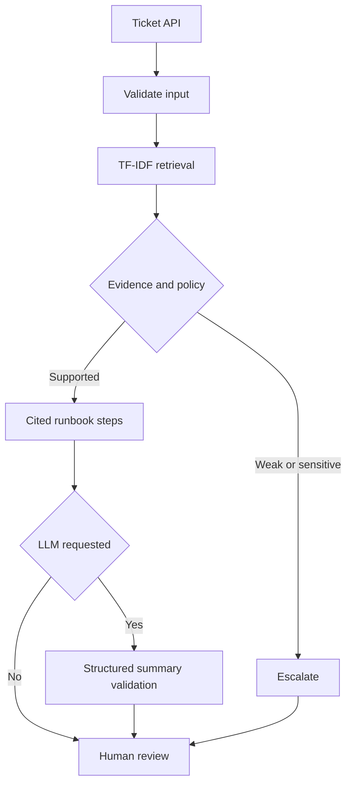

# AI Support Copilot

An evidence-first support triage prototype: turn a ticket into cited troubleshooting steps, a documentation-based category, and an explicit escalation decision.

**Python · FastAPI · scikit-learn · TF-IDF retrieval · optional Ollama RAG · pytest · Docker**

## What it does

- Searches ten original, synthetic support runbooks using TF-IDF and cosine similarity.
- Assigns the top supported runbook's category; this is retrieval-based classification, not a trained classifier.
- Returns troubleshooting steps with source IDs and inspectable source text.
- Abstains on weak retrieval and escalates specialist or potentially unsafe cases.
- Optionally generates a structured summary with a locally configured Ollama model.
- Validates generated output and citation IDs; falls back to cited runbook steps if generation fails.
- Includes a responsive browser interface and interactive OpenAPI documentation.

This is a portfolio prototype, not an autonomous resolution service. It sends no customer messages, changes no accounts, and executes no remediation. All suggestions require human review.

## Quick start

Python 3.12 is the tested version. From this directory:

```bash
python3 -m venv .venv
source .venv/bin/activate
# Windows PowerShell: .venv\Scripts\Activate.ps1
python -m pip install -r requirements-dev.txt
python -m uvicorn app.main:app --reload
```

Open http://127.0.0.1:8000 for the UI or http://127.0.0.1:8000/docs for the API.
The default mode needs no model download, account or API key. Dependencies need internet access at installation.

```bash
curl -X POST http://127.0.0.1:8000/api/analyze \
  -H 'Content-Type: application/json' \
  -d '{"text":"Logged in but getting 403 forbidden on the admin dashboard"}'
```

Example fields: `category`, `summary`, `steps`, `sources`, `retrieval_score`, `escalate`, `escalation_reasons`, `mode`, `generation_status`, `human_review_required`.

## Optional local LLM / RAG

Install Ollama separately and pull a model that fits your hardware, for example `ollama pull llama3.2:3b`. Model availability and hardware needs depend on your installation.

```bash
export OLLAMA_MODEL=llama3.2:3b
export OLLAMA_URL=http://127.0.0.1:11434
python -m uvicorn app.main:app
```

Enable the UI checkbox, or send `"generate": true`. Retrieval supplies runbooks to the model; Pydantic validates the structured summary and the application checks that cited IDs were retrieved. Escalated cases bypass generation. The LLM never controls escalation or replaces the runbook steps.

Without generation, this is a **retrieval baseline**, not an LLM answer. With successful generation, the response mode is **rag**. Citation membership does not prove that a statement is supported: semantic grounding still requires review. No real-model quality benchmark has been run; provider behavior was tested with mocks.

## Architecture



Documents are deliberately short: one runbook is one retrieval unit. The sparse index is built at process startup. Similarity is computed with the dot product of L2-normalized vectors. The 0.16 threshold is a heuristic, not a confidence probability. Runbook category inheritance is a simple auditable baseline; synonym-heavy requests and mixed incidents are weaknesses.

## Evaluation and tests

```bash
python -m pytest -q
python -m evaluation.evaluate --check
```

Measured locally: **16 passing tests**. On the **35 hand-authored synthetic regression examples**: category accuracy 100%, Recall@3 100% (30 examples with relevant sources), escalation accuracy 100%, escalation recall 100% (17 expected escalations). Full output and dataset fingerprint are in `evaluation/report.json`.

These are easy, vocabulary-aligned examples written alongside the runbooks, not independent held-out data or production performance. Do not quote them as real-world accuracy. The evaluator writes a reproducible report and CI checks category accuracy >=80% and escalation recall >=90%. It does not measure generated answer correctness, latency, or real-model robustness.

Tests cover request boundaries, 401/403 separation, unsupported requests, sensitive inputs, invalid model schemas, nonexistent citations, timeouts, valid mocked generation and policy bypass prevention. The matched unsafe patterns are a small defense, not comprehensive prompt-injection protection.

## External benchmark: beyond authored examples

On **all 40 duplicate-charge queries** from the original BANKING77 test split, the unchanged baseline selected the billing category correctly on **32/40 (80%)**, retrieved the billing runbook in its top three on **33/40 (82.5%)**, and escalated **39/40 (97.5%)** under this application's policy. The original dataset supplies intent labels, not escalation or answer-quality labels.

This external single-intent test exposes failures absent from the synthetic examples. It is **not overall real-world accuracy**, does not cover all support categories, and does not establish generated-answer correctness. No tuning was performed on these test queries. See [methodology, uncertainty and validation requirements](evaluation/EXTERNAL_BENCHMARK.md) and [per-row results](evaluation/external_report.json).

## Docker

```bash
docker build -t ai-support-copilot .
docker run --rm -p 127.0.0.1:8000:8000 ai-support-copilot
```

The container runs as a non-root user. Docker build was not executed in the development environment. For Docker Desktop with Ollama on the host, pass `-e OLLAMA_URL=http://host.docker.internal:11434 -e OLLAMA_MODEL=llama3.2:3b`. Linux host routing may require additional configuration.

## Repository guide

| Path | Responsibility |
|---|---|
| `app/core.py` | Retrieval, policy, optional generation and fallback |
| `app/main.py` | Validated HTTP API and UI route |
| `app/index.html` | Accessible labels, evidence panel, loading/error states |
| `knowledge_base/` | Ten authored demo runbooks, no employer data |
| `evaluation/` | Synthetic cases, evaluation script, measured report |
| `tests/` | API and generation contract tests |
| `.github/workflows/ci.yml` | Tests and regression gate on pushes/PRs |

## Demo in two minutes

1. Submit a 403 admin-dashboard ticket. Show the category, permission checks and source IDs.
2. Submit a leaked-token incident. Show mandatory escalation and generation skipped by policy.
3. Ask an unrelated question. Show abstention rather than an invented fix.
4. Open `/docs`, inspect the same API contract, then run the evaluation command.
5. If Ollama is configured, demonstrate a generated summary and explain the fallback.

## Limitations and next steps

English-only, small synthetic corpus; lexical retrieval can miss paraphrases. No durable ticket history, user authentication, rate limiting, tenant separation, redaction pipeline, or production monitoring. Do not expose this unauthenticated prototype directly to the internet or feed it real secrets. Tickets are not persisted by application code; when generation is enabled, they are sent to the configured Ollama service. Server/proxy infrastructure may have its own logging.

Next experiments: independently labeled paraphrase/adversarial set; embeddings or hybrid retrieval compared against this baseline; calibrated abstention using a separate development set; sentence-level grounding checks; real-model answer evaluation; authentication and operational controls before shared deployment.

## Technical references

- [FastAPI testing](https://fastapi.tiangolo.com/tutorial/testing/)
- [scikit-learn text feature extraction](https://scikit-learn.org/stable/modules/feature_extraction.html)
- [Ollama structured outputs](https://docs.ollama.com/capabilities/structured-outputs)

All runbooks and evaluation tickets in this repository are original synthetic examples.
